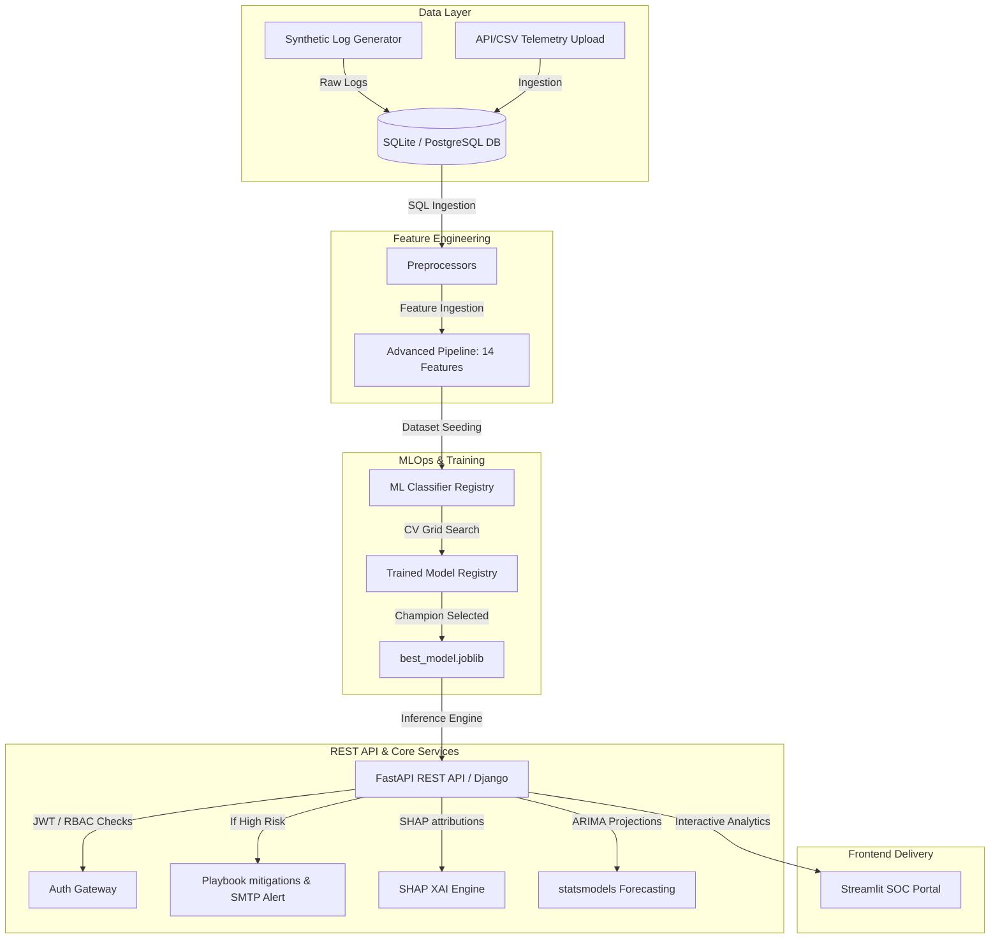

# Advanced Threat Incident Analytics & Security Visualization Framework

An enterprise-grade, machine learning-powered Cybersecurity Analytics and Security Operations Center (SOC) dashboard. The platform ingests telemetry logs, performs advanced security feature engineering, fits and registers ensemble classifiers, provides Explainable AI (XAI) threat drivers via SHAP, runs daily volume forecasts via ARIMA, and executes automated defensive playbooks upon High Risk detections.

---

## 🏛️ Architecture & System Design



---

## 📂 Project Structure

```directory
.
├── api/                   # FastAPI Backend Gateway
│   ├── auth.py            # JWT Auth & Role-Based Access Controls
│   ├── main.py            # REST Endpoints (Predict, Ingest, Forecast, Health)
│   └── models.py          # Pydantic schemas
├── app/                   # Streamlit Frontend Applications
│   ├── components.py      # Custom Plotly components (Forecasts, SHAP plots)
│   └── dashboard.py       # Streamlit GUI with Live Influx Simulation
├── mlops/                 # Model Registry & In-Production Monitoring
│   ├── drift_detector.py  # Population Stability Index (PSI) drift engine
│   └── registry.py        # Model Version registries & promotion controllers
├── models/                # Serialized Model assets & training curves
│   ├── registry/          # Versioned joblib storage bin
│   └── best_model.joblib  # Active production champion model pipeline
├── soc_app/               # Django REST API Application & Viewsets
├── soc_project/           # Django Application Settings & URLs
├── src/                   # Pipeline Core Source Scripts
│   ├── alerting_system.py # Defensive mitigation playbooks & alerts
│   ├── config.py          # Environment settings manager (.env)
│   ├── database_manager.py# SQLAlchemy schemas, models & CRUD actions
│   ├── explainability.py  # Local SHAP attributions compilation
│   ├── feature_engineering.py # 14 Security Feature calculations
│   ├── forecasting.py     # statsmodels ARIMA Trend Forecasting
│   ├── model_training.py  # Grid-search CV ensemble model trainers
│   ├── prediction.py      # Multi-model inference evaluator
│   ├── preprocessing.py   # Data cleaning & validation
│   └── report_generator.py# ReportLab PDF audit report generator
├── tests/                 # Unit, Integration & API Test Suite
├── run_dashboard.bat      # One-click Windows launcher for Streamlit Portal
├── run_api.bat            # One-click Windows launcher for FastAPI Gateway
├── run_django.bat         # One-click Windows launcher for Django Backend
├── seed_db.py             # Database initialization and default user seeder
├── Dockerfile             # Core build parameters
├── docker-compose.yml     # Microservices orchestrator
└── requirements.txt       # Unified platform dependencies
```

---

## ⚡ Quick Start Instructions

### Prerequisites
- Python 3.11+
- System C compiler (needed for LightGBM/CatBoost extension compilations)

---

### Option A: One-Click Windows Launchers (Easiest)
Simply double-click the following batch scripts from the project root:
1. **[run_dashboard.bat](file:///run_dashboard.bat)** — Launches Streamlit SOC Portal at `http://localhost:8501`.
2. **[run_api.bat](file:///run_api.bat)** — Launches FastAPI REST Backend with Swagger Docs at `http://localhost:8000/docs`.
3. **[run_django.bat](file:///run_django.bat)** — Launches Django REST Backend at `http://localhost:8000`.

---

### Option B: Native Terminal / PowerShell Run

1. **Activate Virtual Environment and Set UTF-8**:
   ```powershell
   $env:PYTHONUTF8=1
   $env:PYTHONIOENCODING="utf-8"
   ```

2. **Install Dependencies**:
   ```bash
   pip install -r requirements.txt
   ```

3. **Initialize and Seed Database**:
   ```bash
   python seed_db.py
   ```

4. **Execute Ingest & Training Pipelines (Optional if models exist)**:
   ```bash
   # 1. Generate raw threat dataset
   python src/data_generator.py

   # 2. Preprocess and engineer 14 security features
   python src/feature_engineering.py

   # 3. Train, select, and archive champion model
   python src/model_training.py
   ```

5. **Launch Services**:
   * **Streamlit SOC Portal (Port 8501)**:
     ```bash
     python -m streamlit run app/dashboard.py --server.port 8501
     ```
   * **FastAPI Backend (Port 8000)**:
     ```bash
     python -m uvicorn api.main:app --host 0.0.0.0 --port 8000 --reload
     ```
   * **Django Backend (Port 8000 Alternative)**:
     ```bash
     python manage.py runserver 0.0.0.0:8000
     ```

---

### Option C: Docker Compose
Build, configure, and orchestrate the entire multi-container service environment using one command:
```bash
docker-compose up --build
```
- **Streamlit Front-End Interface**: http://localhost:8501
- **FastAPI REST Backend Swagger Docs**: http://localhost:8000/docs

---

## 🔐 Identity & Access Controls (Default Seeded Users)
Use these seeded accounts inside the Streamlit Lock Screen or API Token Authorization:

| Username | Password | Role | Access Permissions |
| :--- | :--- | :--- | :--- |
| **admin** | `admin123` | **Admin** | Unrestricted access, User administration, MLOps controls, Ingest uploads |
| **analyst**| `analyst123`| **Security Analyst**| Dashboard, Multi-model predictions, Downloads, Explanations, PDF Reports |
| **viewer** | `viewer123` | **Viewer** | Dashboard views, Forecasting graphs (REST writes & uploads blocked) |

---

## 🛡️ Key Dashboard Capabilities

1. **📊 SOC Overview Dashboard**: Real-time KPI metrics, global choropleth attack map, protocol breakdown, and live log simulation toggle.
2. **🔍 Security Logs Explorer**: Full telemetry search, severity filters, device filtering, and CSV download export.
3. **🔮 Threat Prediction Portal**: Multi-model inference providing risk levels (`Low`, `Medium`, `High Risk`), confidence scores, and instant defensive playbooks.
4. **🛡️ SHAP Explainability**: Explains the top threat drivers behind every prediction via SHAP waterfall attributions.
5. **🕸️ MITRE ATT&CK & CVSS Mapping**: Maps incidents directly to MITRE tactics and enterprise CVSS risk scores.
6. **📈 ML Performance Analytics**: Model comparisons across Gradient Boosting, Random Forest, CatBoost, LightGBM, and XGBoost with ROC/PR curves.
7. **🔮 Time-Series Forecasting**: Daily attack volume predictions (7-30 days) powered by statsmodels ARIMA with confidence intervals.
8. **🤖 MLOps Drift & Registry**: Monitors distribution drift with Population Stability Index (PSI) and controls champion model promotions.
9. **👤 User Management**: Admin portal for user provisioning and role adjustments.
10. **📄 Audit PDF Reports**: One-click generation of PDF compliance and incident summary reports.

---

## 🧪 Testing and Quality Assurance
Execute the complete unit, integration, and API test suites alongside coverage reports:

```bash
# Run full Pytest suite
python -m pytest tests/

# Run with coverage report
python -m pytest --cov=src --cov=api --cov=mlops tests/

# Run Django test suite
python manage.py test
```
