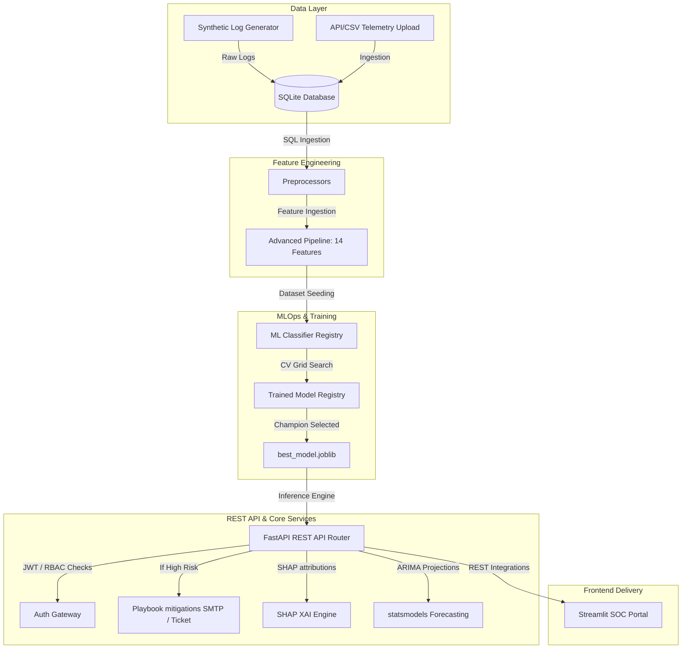

# Advanced Threat Incident Analytics & Security Visualization Framework

An enterprise-grade, machine learning-powered Cybersecurity Analytics and Security Operations Center (SOC) dashboard. The platform ingests telemetry logs, performs advanced security feature engineering, fits and registers ensemble classifiers, provides Explainable AI (XAI) threat drivers via SHAP, runs daily volume forecasts, and executes automated defensive playbooks upon High Risk detections.

---

## 🏛️ Architecture & System Design



---

## 📂 Project Structure

```directory
.
├── api/                   # FastAPI Backend Gateway
│   ├── auth.py            # JWT Auth & Role-Based Access Controls
│   ├── main.py            # REST Endpoints (Predict, Ingest, Forecast, Health)
│   └── models.py          # Pydantic schemas
├── app/                   # Streamlit Frontend Applications
│   ├── components.py      # Custom Plotly components (Forecasts, SHAP plots)
│   └── dashboard.py       # Streamlit GUI with Live Influx Simulation
├── mlops/                 # Model Registry & In-Production Monitoring
│   ├── drift_detector.py  # Population Stability Index (PSI) drift engine
│   └── registry.py        # Model Version registries & promotion controllers
├── models/                # Serialized Model assets & training curves
│   ├── registry/          # Versioned joblib storage bin
│   └── best_model.joblib  # Active production champion model pipeline
├── src/                   # Pipeline Core Source Scripts
│   ├── config.py          # Environment settings manager (.env)
│   ├── database_manager.py# SQLAlchemy schemas, models & CRUD actions
│   ├── explainability.py  # Local SHAP attributions compilation
│   ├── feature_engineering.py # 14 Security Feature calculations
│   ├── forecasting.py     # statsmodels ARIMA Trend Forecasting
│   └── model_training.py  # Grid-search CV ensemble model trainers
├── tests/                 # Unit, Integration & API Test Suite
├── Dockerfile             # Core build parameters
├── docker-compose.yml     # Microservices orchestrator
└── requirements.txt       # Unified platform dependencies
```

---

## ⚡ Quick Start Instructions

### Prerequisites
- Python 3.11+
- System C compiler (needed for LightGBM/CatBoost extension compilations)

### Option A: Native Local Run
1. **Clone the repository and install dependencies**:
   ```bash
   pip install -r requirements.txt
   ```
2. **Execute Ingest & Training Pipelines**:
   ```bash
   # Generate raw threat dataset
   python src/data_generator.py
   
   # Preprocess and engineer features
   python src/feature_engineering.py
   
   # Train, select, and archive champion model
   python src/model_training.py
   ```
3. **Initialize and Seed Database**:
   ```bash
   python -c "from src.database_manager import initialize_database; initialize_database(); print('DB Initialized!')"
   # Seed default accounts (admin / admin123, analyst / analyst123, viewer / viewer123)
   python seed_db.py
   ```
4. **Launch REST API Backend**:
   ```bash
   uvicorn api.main:app --host 0.0.0.0 --port 8000
   ```
5. **Launch Streamlit SOC Portal**:
   ```bash
   streamlit run app/dashboard.py --server.port 8501
   ```

### Option B: Docker Compose (Recommended)
Build, configure, and orchestrate the entire multi-container service environment using one command:
```bash
docker-compose up --build
```
- Streamlit Front-End Interface is served at: http://localhost:8501
- FastAPI REST Backend API Swagger docs are served at: http://localhost:8000/docs

---

## 🔐 Identity & Access Controls (Seeded)
Use these seeded accounts inside the Streamlit Lock Screen or API Token Authorization:

| Username | Password | Role | Access Permissions |
| :--- | :--- | :--- | :--- |
| **admin** | `admin123` | **Admin** | Unrestricted access, User registrations, MLOps controls |
| **analyst**| `analyst123`| **Security Analyst**| Dashboard, Predictions, Downloads, Explanations |
| **viewer** | `viewer123` | **Viewer** | Dashboard views, Forecasting graphs (REST writes blocked) |

---

## 🧪 Testing and Validation
Run the unit, integration, and API test suites alongside code coverage reports:
```bash
python -m pytest --cov=src --cov=api --cov=mlops tests/
```
