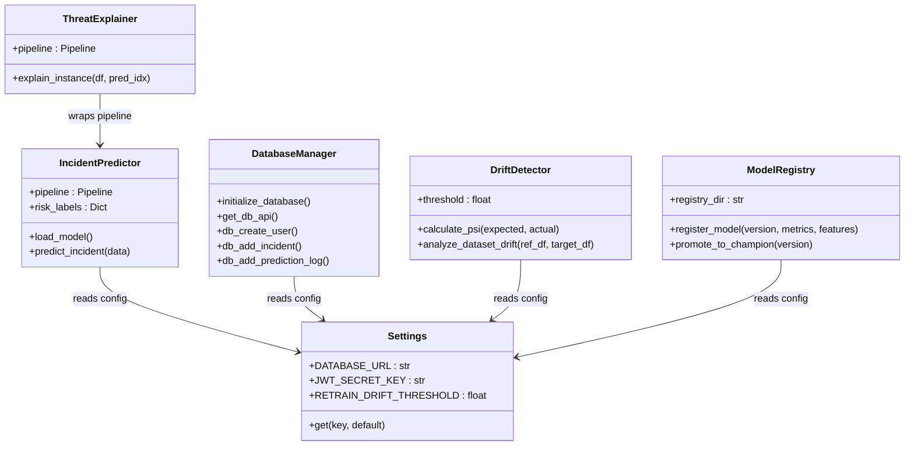
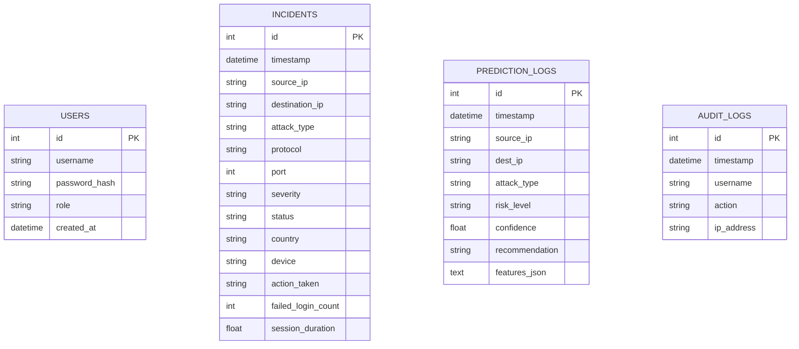

# SOC Threat Incident Framework: Developer Guide

This document acts as a technical reference guide for software engineers, machine learning engineers, and data engineers extending the codebase.

---

## 🏛️ System & Class Diagram Architecture



---

## 💾 Database Schema (ER Diagram)



---

## 🤖 How to Add a New Machine Learning Model

To add a new model pipeline to the comparative cross-validation grid search:

1. **Open `src/model_training.py`**.
2. Locate the model configuration grids definition in `run_ml_pipeline()`:
   ```python
   models = {
       "Random Forest": RandomForestClassifier(random_state=42),
       "XGBoost": XGBClassifier(use_label_encoder=False, eval_metric='mlogloss', random_state=42),
       # ADD YOUR NEW ESTIMATOR HERE:
       "SVR": SVC(probability=True, random_state=42)
   }
   ```
3. Define its hyperparameter grid in the `grids` dictionary:
   ```python
   grids = {
       "SVR": {
           "classifier__C": [0.1, 1.0, 10.0],
           "classifier__kernel": ["rbf", "linear"]
       }
   }
   ```
4. Run the training command:
   ```bash
   python src/model_training.py
   ```
   The training loop will automatically fit your model, compute scores, output comparative bar plots, compare it against Gradient Boosting, and serialize the best pipeline model to `models/best_model.joblib`.

---

## 🛠️ Extending Django REST Gateways

To add a new API endpoint to the Django REST layer:

1. **Add Model fields**: Update `soc_app/models.py`. Run:
   ```bash
   python manage.py makemigrations
   python manage.py migrate
   ```
2. **Configure Serializer**: Open `soc_app/serializers.py` and declare a new serializer subclass mapping the input validation requirements.
3. **Write View logic**: Open `soc_app/views.py` and create an APIView or ViewSet class. Apply permission restrictions (e.g., `permission_classes = [IsSecurityAnalystOrAdmin]`).
4. **Map URL Route**: Add the path mapping to the list inside `soc_project/urls.py`.
5. **Run tests**:
   ```bash
   python manage.py test
   ```
