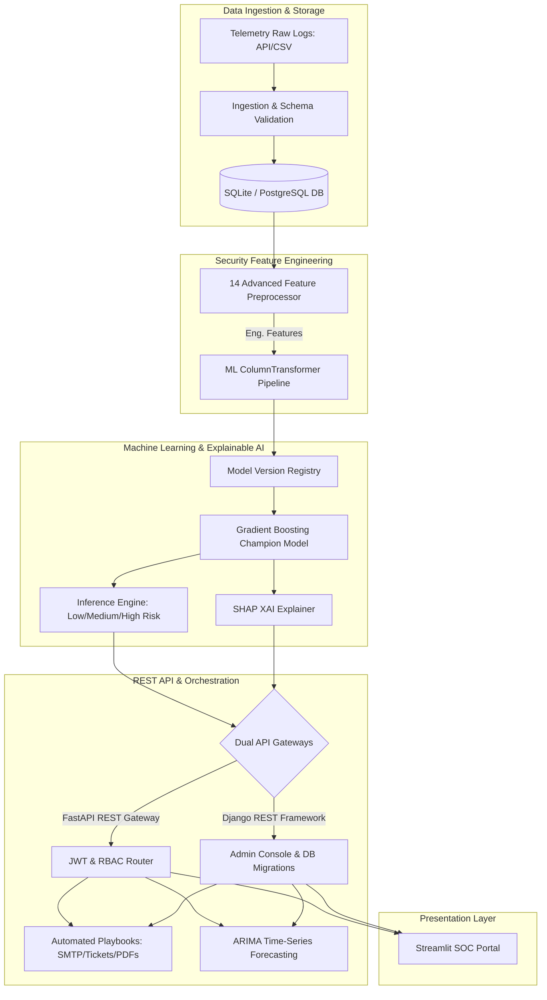

# Project Abstraction: Advanced Threat Incident Analytics & Security Visualization Framework

An enterprise-grade, machine learning-powered Cybersecurity Analytics and Security Operations Center (SOC) visualization platform designed to alleviate alert fatigue, establish model transparency, automate response workflows, and monitor production drift.

---

## 📄 Abstract

Modern Security Operations Centers (SOCs) are overwhelmed by millions of daily security telemetry logs, leading to cognitive overload and delayed incident containment. This project addresses these challenges by developing an end-to-end, containerized **Advanced Threat Incident Analytics & Security Visualization Framework**. 

The platform ingests multi-source raw log data, processes them through a pipeline that dynamically computes **14 custom security features** (capturing behavioral velocity, statistical anomalies, and historical reputations), and applies supervised machine learning to classify threats into *Low*, *Medium*, or *High Risk*. Out of six evaluated architectures, the **Gradient Boosting Classifier** serves as the production champion, achieving a **90.80% accuracy** and a **90.63% weighted F1-score**. 

To overcome the "black-box" nature of ensemble models, the framework incorporates local **SHAP (SHapley Additive exPlanations)** attributions, translating numerical feature impacts into clear, natural language explanations for SOC analysts. Future incident counts are projected using a statsmodels **ARIMA(1,1,1)** forecasting engine to optimize analyst resource allocation. Ingress telemetry drift is detected via the **Population Stability Index (PSI)**, prompting automated retraining when the threshold is violated ($PSI \ge 0.25$).

The application exhibits a decoupled, microservices-oriented **dual API architecture**—supporting both a lightweight, high-performance **FastAPI REST Gateway** and a robust **Django REST Framework (DRF)** backend equipped with built-in audit logs and administrative dashboards. Both backends are secured using JSON Web Tokens (JWT) and Role-Based Access Control (RBAC). Finally, real-time analytics are visualized via an interactive **Streamlit SOC Portal** while high-risk predictions trigger automated playbooks (generating compliance PDFs, critical audit logs, and ticketing-system payloads).

---

## 🏛️ System Architecture

The platform operates across five logical layers, designed to run in a containerized environment:

---

## ⚙️ Core Technical Abstractions

### 1. Data Ingest & Telemetry Science
The framework ingests raw event telemetry (including IP addresses, attack types, protocols, ports, and session details). A schema-validation layer enforces type safety, rejecting malformed log data prior to storage. 
* **Database Manager**: Connects to the SQLite or PostgreSQL backend using SQLAlchemy ORM (FastAPI) and Django ORM (DRF), maintaining historical logs of threat events, prediction history, and administrator audit trails.

### 2. Feature Engineering Pipeline
The system computes **14 custom security features** designed to capture sophisticated attack signatures:
* **Temporal Indicators**: `Hour`, `Weekend_Flag`, and `Login_Time_Anomaly` (detecting off-hours behavior).
* **Behavioral Velocity**: `Attack_Velocity` and `Failed_Login_Frequency` (tracking rolling activity frequencies).
* **Reputation Indices**: `IP_Reputation_Score` (ratio of historical actions taken), `Country_Risk_Score`, and `Device_Risk_Score`.
* **Statistical Anomalies**: `Session_Duration_Anomaly` (exfiltration indicators), `Geographic_Anomaly_Score` (impossible travel), and `Attack_Burst_Detection`.
* **Composite Risk**: `Normalized_Risk_Score` mapping values onto a unified $[0.0, 10.0]$ scale.

### 3. Model Training & Champion Promotion
A pipeline-based training workflow processes mixed-type telemetry:
* **Preprocessors**: Standardizes numerical fields and encodes categorical attributes (`OneHotEncoder` ignoring unknown keys).
* **Stratified Cross-Validation**: Compares Random Forest, XGBoost, LightGBM, CatBoost, Extra Trees, and Gradient Boosting.
* **Registry & Promotion**: Saves versioned binaries to `/models/registry/`. If a newly trained model outperforms the current production champion in validation F1-score, it is automatically promoted to the active `best_model.joblib`.

### 4. Explainable AI (XAI) Engine
To foster trust in automated decisions, local SHAP values are extracted from the champion model at prediction time. The XAI engine maps game-theoretic values to the corresponding feature values and translates positive/negative risk drivers into localized, plain-English sentences for analysts.

### 5. Time-Series Forecasting
Using statsmodels **ARIMA(1,1,1)**, the platform forecasts cumulative daily threat volumes up to 30 days in advance. Forecasting includes 95% confidence intervals to assist SOC management in capacity planning and shift scheduling.

### 6. Dual API Gateways (FastAPI & Django REST Framework)
To showcase architectural versatility and serve diverse enterprise requirements, the project integrates two independent backends:
1. **FastAPI REST API**: Optimized for sub-millisecond, lightweight, async-capable threat validations and microservice integration.
2. **Django REST Framework (DRF)**: Tailored for robust user database modeling, administrative overrides, built-in audit records, and database migrations.
* Both API configurations implement **JWT authentication** with three roles: **Admin** (unrestricted configuration), **Security Analyst** (read/write predictions & dashboards), and **Viewer** (read-only charts).

### 7. Automated Defensive Playbooks
Upon predicting a *High Risk* threat, the platform immediately triggers containment playbooks:
* Generates a formal **compliance case PDF report** containing incident telemetry, ML confidence, and recommended mitigations.
* Serializes a standard **ServiceNow/Jira JSON ticket** for security ticketing integrations.
* Triggers administrative warnings and commits a critical log to the database audit registry.

### 8. MLOps Drift Detection
The incoming dataset distribution is monitored against the training baseline utilizing the **Population Stability Index (PSI)**. If data drift is detected ($PSI \ge 0.25$), a warning is displayed on the dashboard recommending model retraining.

---

## 🛠️ Technology Stack

| Component | Technology / Library | Description |
| :--- | :--- | :--- |
| **Programming Language** | `Python 3.11+` | Core platform language |
| **Frontend Framework** | `Streamlit` | Interactive SOC dashboard and UI portal |
| **API Gateways** | `FastAPI` / `Django REST Framework` | Dual backend APIs for performance & control |
| **Machine Learning Core**| `scikit-learn`, `XGBoost`, `LightGBM`, `CatBoost` | Classifier training & evaluation pipelines |
| **Explainable AI (XAI)** | `SHAP` | Game-theoretic feature attribution |
| **Forecasting Engine** | `statsmodels (ARIMA)` | Time-series projection |
| **Databases** | `SQLite` / `PostgreSQL` | Secure threat storage & audit tables |
| **ORMs** | `SQLAlchemy` / `Django ORM` | Database abstractions |
| **Containerization** | `Docker` / `Docker Compose` | Multi-container environment orchestration |
| **Document Generation** | `ReportLab` | Automated PDF incident reporting |
