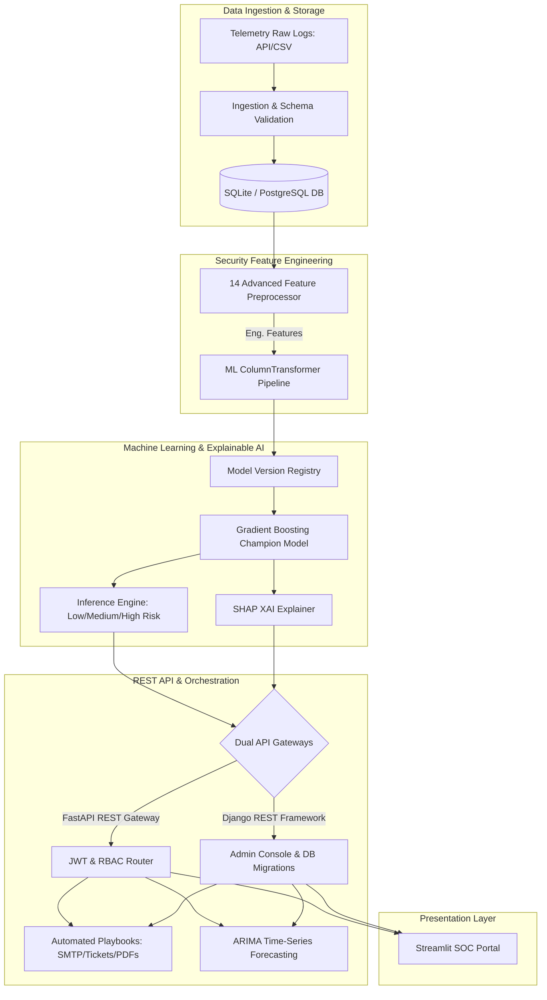

# System Specification Document
## Advanced Threat Incident Analytics & Security Visualization Framework

---

## 1. Title
**Advanced Threat Incident Analytics & Security Visualization Framework**

---

## 2. Project Overview
The **Advanced Threat Incident Analytics & Security Visualization Framework** is an enterprise-grade, machine learning-powered Cybersecurity Analytics and Security Operations Center (SOC) dashboard. The platform is designed to alleviate analyst alert fatigue, establish machine learning model transparency (Explainable AI), automate containment workflows, and monitor telemetry drift in production.

Modern enterprise networks ingest billions of daily events, rendering manual inspection impossible. This framework resolves this problem by implementing a containerized, end-to-end data pipeline. The pipeline:
1. Ingests raw multi-source event telemetry and validates log structures against defined Pydantic schemas.
2. Performs real-time security feature engineering, generating **14 custom security features** covering behavioral velocity, temporal anomalies, country/device risk profiles, and statistical deviations.
3. Classifies events into *Low*, *Medium*, or *High Risk* severities using a production-ready **Gradient Boosting Classifier** (champion model selected from 6 architectures with **90.80% accuracy** and **90.63% weighted F1-score**).
4. Translates complex machine learning decision pathways into plain-English explanations using **SHAP (SHapley Additive exPlanations)**.
5. Projects daily threat incident counts 30 days into the future using a statsmodels **ARIMA(1,1,1)** forecasting model.
6. Evaluates incoming distribution changes via the **Population Stability Index (PSI)** to notify analysts of data drift.
7. Executes **Automated Defensive Playbooks** (generating compliance PDFs, critical audit trails, and ticketing payloads) when *High Risk* threat indicators are detected.

The platform utilizes a decoupled microservices design powered by a **dual-API gateway** backend (FastAPI and Django REST Framework) and served to security analysts via an interactive **Streamlit SOC Portal**.



---

## 3. Software Requirements

The application runs in a containerized environment or locally using Python 3.8 to 3.11. The software dependencies are structured as follows:

| Category | Dependency / Library | Minimum Version | Description / Purpose |
| :--- | :--- | :--- | :--- |
| **Core Runtime** | `Python` | `3.11+` | Core programming language runtime |
| **User Interface** | `Streamlit` | `>=1.25.0` | Interactive SOC dashboard and UI portal |
| **API Frameworks** | `FastAPI` | `>=0.100.0` | Async backend REST API for real-time inference |
| | `django` | `>=4.2.0` | Secure administration, user database, and migrations |
| | `djangorestframework`| `>=3.14.0` | Django REST Framework for secondary API services |
| **ML Engine** | `scikit-learn` | `>=1.2.0` | Core machine learning pipeline & standard classifiers |
| | `xgboost` | `>=1.7.0` | eXtreme Gradient Boosting ensemble model |
| | `lightgbm` | `>=4.0.0` | Light Gradient Boosting Machine ensemble model |
| | `catboost` | `>=1.2` | CatBoost categorical-aware ensemble classifier |
| | `joblib` | `>=1.3.0` | Model serialization and loading pipeline |
| **Explainable AI** | `shap` | `>=0.42.0` | Game-theoretic feature attribution explanations |
| **Forecasting** | `statsmodels` | `>=0.14.0` | ARIMA time-series incident count projections |
| **Data Science** | `pandas` | `>=2.0.0` | Data structure manipulation and processing |
| | `numpy` | `>=1.24.0` | Mathematical array computations |
| **Visualization** | `plotly` | `>=5.15.0` | High-quality interactive dashboard plots |
| | `matplotlib` | `>=3.7.0` | Offline plotting utility |
| | `seaborn` | `>=0.12.0` | Statistical data visualization framework |
| **PDF Generation** | `reportlab` | `>=4.0.0` | Programmatic incident report creation |
| **Database Drivers** | `sqlalchemy` | `>=2.0.0` | SQL abstraction Layer for FastAPI |
| | `psycopg2-binary` | `>=2.9.0` | PostgreSQL database connection driver |
| | `pymysql` | `>=1.1.0` | MySQL database connection driver |
| **Security / Auth** | `djangorestframework-simplejwt` | `>=5.2.0` | JWT tokens authorization helper for Django |
| | `django-cors-headers`| `>=4.0.0` | Cross-Origin Resource Sharing control handler |
| | `pydantic` | `>=2.0.0` | Strict schema data validation |
| **Testing** | `pytest` / `pytest-cov`| `>=7.3.0` | Unified test suite execution and coverage checks |
| **Deployment** | `Docker` / `Docker Compose` | Latest | Multi-container microservice orchestration |

> [!NOTE]
> System compilers (e.g., GCC, Clang, or MSVC) are required during native setup to compile high-performance backend C++ extensions for `LightGBM` and `CatBoost` libraries.

---

## 4. Hardware Requirements

To support log ingestion pipelines, real-time predictions, feature computation, statsmodels forecasting, and on-demand model retraining, the following hardware profiles are recommended:

### A. Minimal Development Environment (Local Setup)
* **Processor (CPU)**: Dual-Core Intel Core i5 or AMD Ryzen 5 (2.0 GHz or higher).
* **Random Access Memory (RAM)**: 8 GB DDR4.
* **Storage**: 10 GB available SSD space (for dependencies, SQLite data logs, and local model binaries).
* **Graphics Unit (GPU)**: Integrated GPU (not required; training runs are CPU-optimized).

### B. Standard Enterprise Production Environment
* **Processor (CPU)**: Quad-Core Intel Xeon, AMD EPYC, or cloud equivalents (e.g., AWS EC2 `t3.medium` or `c5.large` instances).
* **Random Access Memory (RAM)**: 16 GB DDR4/DDR5 (necessary for holding larger validation data frames and executing parallel grid searches).
* **Storage**: 50 GB+ High-Speed NVMe SSD (to support growing incident database partitions, model registries, and PDF report archives).
* **Network Interface**: 100 Mbps or higher ethernet connection (vital for handling asynchronous, sub-millisecond API request loads from multiple remote sensors).

---

## 5. Modules

The framework is architected as a modular pipeline where components communicate via structured interfaces and APIs:

```
[Telemetry Logs] -> [Ingestion Module] -> [Feature Engineering] -> [ML Classifier] -> [API Gateway / Playbooks] -> [Streamlit UI]
```

### A. Ingestion & Storage Module
* **Purpose**: Handles multi-source telemetry logs (CSV uploads, JSON logs, or direct API streams), validating structural attributes using Pydantic schemas before writing to the database.
* **Storage Engines**: Support for SQLite (lightweight/local development) and PostgreSQL/MySQL (highly concurrent production databases). Access is managed via SQLAlchemy ORM (FastAPI) and Django ORM (Django).

### B. Security Feature Engineering Module
* **Purpose**: Transforms raw, low-level network log lines (timestamps, IP addresses, ports, attack protocols) into **14 custom security features**:
  * *Temporal Features*: `Hour`, `Weekend_Flag`, `Login_Time_Anomaly` (detects out-of-hours exploits).
  * *Behavioral Velocity*: `Attack_Velocity` and `Failed_Login_Frequency` (tracks rolling rates per IP).
  * *Reputations*: `IP_Reputation_Score`, `Country_Risk_Score`, `Device_Risk_Score`.
  * *Statistical Indicators*: `Session_Duration_Anomaly`, `Geographic_Anomaly_Score`, `Attack_Burst_Detection` (identifies botnets/DDoS).
  * *Composite Scoring*: `Normalized_Risk_Score` mapping telemetry attributes to a scale of $[0.0, 10.0]$.

### C. Machine Learning & Champion Promotion Module
* **Purpose**: Evaluates 6 major ensemble classifiers (Random Forest, XGBoost, LightGBM, CatBoost, Extra Trees, and Gradient Boosting) using stratified 3-fold cross-validation.
* **Champion Model**: The architecture with the highest validation weighted F1-score is promoted to production (`best_model.joblib`).
* **Registry Controller**: Automatically archives trained artifacts to versioned storage directories under `/models/registry/`.

### D. Explainable AI (XAI) Engine
* **Purpose**: Solves the "black-box" model problem. By extracting local SHAP values at inference time, it identifies the features that pushed the score higher or lower.
* **NLP Explainer**: Translates raw numerical SHAP values into simple natural-language explanations (e.g., *"Failed login count (value: 5) increased threat risk significantly"*).

### E. Time-Series Forecasting Module
* **Purpose**: Provides SOC managers with foresight on staffing and infrastructure needs.
* **Forecasting Engine**: Fits a statsmodels ARIMA(1,1,1) model over past daily threat counts, projecting future trends 30 days ahead with 95% confidence intervals.

### F. Dual API Gateways Module
* **FastAPI Gateway**: Asynchronous backend optimized for sub-millisecond REST endpoints (`/api/predict`, `/api/predict/explain`, `/api/forecast`, `/api/health`).
* **Django REST Framework (DRF)**: Handles robust user authentication database structures (JWT with expiration controls), role-based access control checking (Admin, Security Analyst, Viewer roles), and administrative audits.

### G. Automated Defensive Playbooks Module
* **Purpose**: Decreases the Mean Time to Resolution (MTTR) for critical threats.
* **Actions**: If a prediction returns *High Risk*, the module automatically generates a ReportLab-crafted executive PDF incident log, generates a JSON payload for ServiceNow/Jira integrations, writes a critical event log, and triggers simulated email notifications.

### H. MLOps Drift Detection Module
* **Purpose**: Continuous performance monitoring.
* **Algorithm**: Calculates the Population Stability Index (PSI) to compare baseline training datasets with current live API inputs:
  $$PSI = \sum_{i=1}^{B} \left( (A_i - E_i) \times \ln\left(\frac{A_i}{E_i}\right) \right)$$
* **Retraining Flags**: Alerts the admin to initiate model retraining when the index breaches critical thresholds ($PSI \ge 0.25$).

### I. Presentation Layer (Streamlit SOC Portal)
* **Purpose**: Serves as the graphical command interface for security analysts.
* **Screens**:
  1. *Dashboard Overview*: Heatmaps, world map threat distribution, KPIs, and live log simulation.
  2. *Incident Explorer*: Search, filter, and export tool for security logs.
  3. *Real-Time Threat Predictor*: Form interface to score threats manually and view playbooks.
  4. *ML Model Performance*: Displays validation curves, confusion matrices, and model comparison graphs.
  5. *Reports Centre*: Central hub to download compliance CSVs or incident summary PDFs.

---

## 6. Existing System

Traditional Security Operations Centers (SOC) rely on legacy tools and manual triage configurations to manage security incidents:

* **Signature-Based SIEMs**: Security Information and Event Management (SIEM) systems detect malicious activity primarily using static, hardcoded rules (e.g., flag if login attempts exceed 10, or if IP is on a static blacklist).
* **Manual Alert Triage**: Security analysts manually review a chronological stream of warnings generated by network sensors, web application firewalls (WAF), and endpoint logs.
* **Static Visual Reporting**: Reports consist of raw tables or static retrospective charts (e.g., "threats last week") with no capacity to predict future threats.
* **Siloed Mitigation Actions**: Upon identifying a genuine breach, analysts must manually trigger isolation commands, write tickets in JIRA/ServiceNow, draft incident summaries, and notify internal stakeholders.
* **Blind Model Deployment**: If ML models are utilized in legacy systems, they are deployed statically. They lack data-drift detection pipelines, meaning models silently degrade in accuracy over time as attacker tactics evolve.

---

## 7. Proposed System

The proposed **Advanced Threat Incident Analytics & Security Visualization Framework** introduces an automated, containerized, and ML-driven approach to security monitoring:

* **Heuristics & ML Classification**: Instead of simple static rules, a preprocessor computes 14 complex behavioral telemetry features. These features are evaluated by an ensemble ML classifier, mapping non-linear relationships to predict risk categories (*Low*, *Medium*, *High*) with over 90% accuracy.
* **Transparent Artificial Intelligence**: The inclusion of a SHAP XAI engine ensures that security analysts do not have to guess why a model flagged an event. Feature contributions are translated directly into plain-English justifications on the dashboard.
* **Automated Containment SOAR Playbooks**: High-risk incidents trigger Security Orchestration, Automation, and Response (SOAR) playbooks. The system automatically creates ticketing-ready files and compliance reports, saving hours of manual analyst response time.
* **Forward-Looking Capacity Planning**: The statsmodels ARIMA forecasting engine provides predictive analysis of daily incident counts, allowing management to schedule analyst shifts before spikes occur.
* **Dual-API Microservice Framework**: Leverages FastAPI for high-performance low-latency inference, alongside Django REST Framework to enforce enterprise security, JWT authentication, and database integrity audits.
* **Active MLOps Drift Detection**: A background worker continuously monitors the statistical distributions of incoming logs. If a distribution shift occurs, the Population Stability Index triggers retraining notifications, ensuring the system remains resilient against changing threat patterns.

---

## 8. Problems / Limitations of Existing System

The limitations of traditional security setups include:

* **Extreme Alert Fatigue**: Static, signature-based systems generate thousands of alerts daily, over 90% of which are false positives. Analysts suffer from cognitive overload, causing them to miss actual stealth attacks.
* **The "Black Box" Trust Deficit**: Analysts frequently bypass ML-driven risk scores because there is no clear explanation of what features triggered the risk flags. Without explainability, automation cannot be trusted.
* **High Mean Time to Resolution (MTTR)**: Disconnected tools require manual copying of telemetry data to create tickets, compose executive PDFs, and execute blocklists, delaying threat containment.
* **Lack of Predictive Readiness**: Being purely reactive, legacy systems do not warn administrators of incoming threat volume surges, leading to under-staffed shifts during critical attacks.
* **Silent Model Drift**: Without active drift monitoring, models deployed in production quickly lose relevance due to concept drift (changes in normal system behavior) and covariate drift (new attacker vectors), resulting in missed detections.
* **Poor Security Governance**: Lack of unified, granular, role-based controls (Viewer, Analyst, Admin) on REST endpoints makes legacy database dashboards susceptible to unauthorized overrides or modifications.
